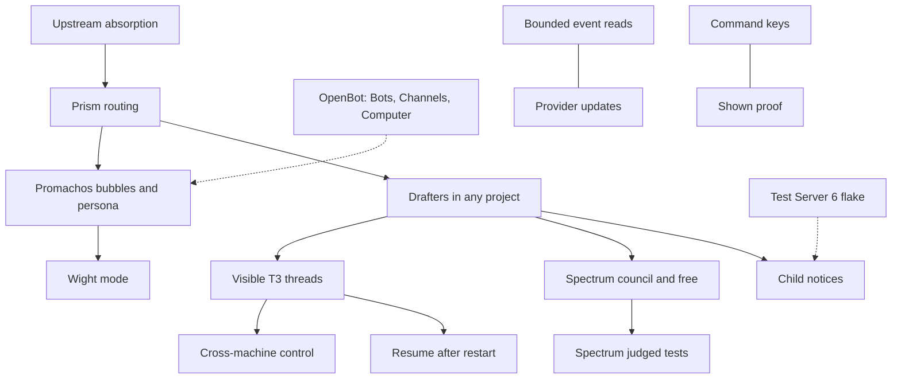

# Chromeria map

The parts of Chromeria and how they connect. The Map tab colours each part from
GitHub: planned, working, broken or done.

Each part is declared once as `ID["Name"]`. The comment line `%% ID: refs` under it
names the part's Issues and pull requests; the first ref is the primary ref, which
decides planned, working or done. `%% ID: context` marks a part this project draws
but does not track. GitHub ignores these comment lines.

Change this map in the pull request that adds, splits, merges or removes a part.

## Work that is not a part

| Work               | Why it is not a part                                                                                                                                               |
| ------------------ | ------------------------------------------------------------------------------------------------------------------------------------------------------------------ |
| Network routes     | Reaching one environment over several routes already landed from upstream (`979ca66ced`, pingdotgg/t3code#15467). No open Chromeria issue owns a remaining change. |
| OpenBot spike (#7) | Closed as not planned. The OpenBot part points at the direction pull request in toolboxmd/openbot.                                                                 |
| v2 cutover (#177)  | The landing umbrella. Promachos, Wight, Drafters, Spectrum and Prism cite their own issues.                                                                        |
