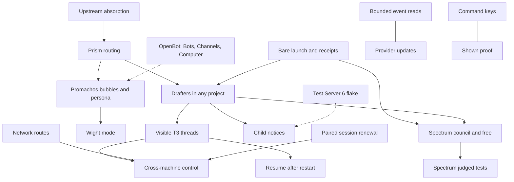

# Chromeria map

The parts of Chromeria and how they connect. The Map tab colours each part from
GitHub: planned, working, broken or done.

Each part is declared once as `ID["Name"]`. The comment line `%% ID: refs` under it
names the part's Issues and pull requests; the first ref is the primary ref, which
decides planned, working or done. `%% ID: context` marks a part this project draws
but does not track. GitHub ignores these comment lines.

Change this map in the pull request that adds, splits, merges or removes a part.

## Work that is not a part

| Work              | Why it is not a part                                                                                                                                                                                                                |
| ----------------- | ----------------------------------------------------------------------------------------------------------------------------------------------------------------------------------------------------------------------------------- |
| OpenBot mode      | Drawn as OB, a context part. toolboxmd/openbot#142 only records the direction, so it cannot be the primary ref: the tab would colour the mode done. Chromeria spike #7 closed as not planned, and no open issue owns the mode here. |
| v2 cutover (#177) | The landing umbrella. Promachos, Wight, Drafters, Spectrum and Prism cite their own issues.                                                                                                                                         |
